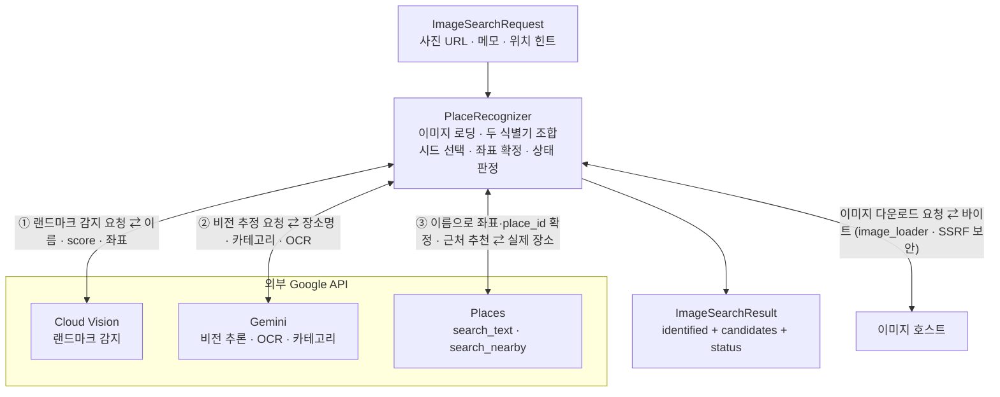

# 📸 Image Search

사진 한 장을 여행 장소 후보로 바꾸는 **사진 기반 장소 검색** 모듈입니다.

이 모듈은 사진을 이해하는 일은 AI(Gemini)에 맡기되, **좌표와 사실은 항상 Google Places의 실제 값으로 확정**합니다. 랜드마크 감지가 준 좌표조차 신뢰하지 않고 Places로 재확정해, 환각(hallucination)으로 인한 잘못된 위치를 차단합니다.

> 형제 모듈: [Route Planner](../route_planner/README.md) · [Free Time Recommender](../free_time_recommender/README.md)

<br>

## 📚 목차

1. [🎯 모듈 역할](#-모듈-역할)
2. [🔄 전체 처리 흐름](#-전체-처리-흐름)
3. [🧠 캐스케이드 식별](#-캐스케이드-식별)
4. [🧭 증거 기반 후보](#-증거-기반-후보)
5. [📍 좌표는 항상 Places](#-좌표는-항상-places)
6. [🗂️ 카테고리와 근처 추천](#-카테고리와-근처-추천)
7. [🌐 Modal HTTP 엔트리포인트](#-modal-http-엔트리포인트)
8. [🔒 이미지 로딩 보안](#-이미지-로딩-보안)
9. [📥 입력과 출력](#-입력과-출력)
10. [🧪 테스트 관점](#-테스트-관점)
11. [📁 디렉터리 구조](#-디렉터리-구조)
12. [⚠️ 현재 한계](#-현재-한계)
13. [🔗 세부 문서](#-세부-문서)

<br>


## 🎯 모듈 역할

`ai/image_search`는 다음 문제를 처리합니다.

- 사진(URL 또는 로컬 경로)을 받아 촬영된 장소를 추정합니다.
- 랜드마크 감지와 비전 LLM 두 식별기를 함께 돌려 서로를 보완합니다.
- 추정한 장소명을 Google Places로 검색해 실제 좌표·place_id·주소를 확정합니다.
- 식별한 장소 주변의 관련 장소를 추천 후보로 덧붙입니다.
- 사용자 메모와 위치 힌트를 인식 맥락으로 반영합니다.
- 결과를 백엔드 계약 DTO(`ImageSearchResult`)로 돌려주고, 인식 성공·부분·실패 상태를 함께 전달합니다.

이 모듈은 사진을 이해하는 데 AI를 사용합니다. 다만 **좌표·place_id·주소 같은 사실 정보는 AI 출력에 의존하지 않고 항상 Google Places의 실제 응답으로 확정**합니다.

```text
AI가 판단하는 것    "무엇을 찍었는가" (장소명 추정 · 카테고리 · 분위기)
Places가 확정하는 것 "그곳이 어디인가" (좌표 · place_id · 주소 · 평점)
```

> **관련 문서**
>
> - [Services](./services/README.md) — 두 식별기를 캐스케이드로 조합하는 실행 계층
> - [Providers](./providers/README.md) — Cloud Vision · Gemini · Places 외부 연동
> - [Domain](./domain/README.md) — 요청·응답 계약과 provider 원신호 모델

<br>

## 🔄 전체 처리 흐름



외부 소스로 향하는 화살표는 모두 **양방향(요청 ⇄ 응답)** 입니다. `PlaceRecognizer`는 이미지를 내려받고(또는 로컬 경로를 읽고), 랜드마크 감지(Cloud Vision)와 비전 추론(Gemini)을 **매 요청마다 모두** 호출하며, Places로 좌표·place_id를 확정하고 근처를 추천합니다. 요청(`ImageSearchRequest`)이 들어오고 결과(`ImageSearchResult`)가 나가는 두 화살표만 단방향입니다. **좌표·place_id 같은 사실은 오직 Places 응답으로만 확정됩니다.**

```text
요청 검증
→ 이미지 로딩 및 보안 검증(image_loader)
→ 두 식별기 병행 실행(랜드마크 감지 + 비전 LLM)
→ 시드를 근거가 강한 순으로 시도(랜드마크 → LLM 추정 → 읽은 간판 글자)
→ Places 이름 검색으로 좌표·place_id 확정(위치 prior 주변으로 편향, 여러 건 수신)
→ 동명 후보와 주변 장소 추천(confidence 순차 감소 · place_id 중복 제거)
→ 인식 상태 판정
→ 최종 응답 반환
```

`PlaceRecognizer`가 전체 처리 순서를 조정합니다.

1. 이미지 소스를 한 곳에서 로딩해 두 식별기에 같은 바이트를 넘깁니다.
2. 이미지 바이트로 MIME 타입을 감지해 Gemini에 올바른 타입을 전달합니다.
3. 랜드마크 감지와 비전 LLM을 매 요청마다 모두 실행합니다.
4. 두 결과에서 검색 시드를 근거가 강한 순으로 만듭니다.
5. 시드를 차례로 Places에 검색해, 처음 결과가 나온 시드로 좌표·place_id를 확정합니다.
6. 같은 이름의 다른 결과(동명 후보)와 확정 좌표 주변의 근처 추천으로 후보를 채웁니다.
7. 인식 상태를 판정해 `ImageSearchResult`를 반환합니다.

> **관련 문서**
>
> - [Services](./services/README.md) — `PlaceRecognizer.search`의 단계별 구현

<br>


## 🧠 캐스케이드 식별

두 식별기를 병행한 뒤, 어느 결과를 "시드(seed)"로 삼을지 고르는 것이 캐스케이드의 핵심입니다. "폴백"이라는 이름과 달리 **두 식별기는 매 요청마다 모두 호출**되며, 캐스케이드는 그 결과 중 무엇을 채택할지 결정하는 내부 로직입니다.

### 두 식별기

- **LandmarkProvider (Cloud Vision)** — 에펠탑·센소지처럼 이름이 붙은 유명 랜드마크에 강합니다. 이름과 좌표, `score`(0~1)를 반환합니다.
- **VisionLlmProvider (Gemini)** — 카페·골목·음식·간판처럼 이름이 겉으로 드러나지 않는 일반 장소와 분위기에 강합니다. 장소명 추정·카테고리·분위기 키워드·OCR 텍스트를 반환합니다.

### 시드 선택 규칙

```text
랜드마크 score ≥ 0.6       → 랜드마크 이름을 시드로 채택
그 외 · LLM 추정이 있으면   → LLM 장소명 추정을 시드로 채택
둘 다 없거나 검색 실패      → 읽은 간판 글자로 폴백 (아래 "증거 기반 후보")
그래도 없으면              → 위치 힌트 주변 탐색, 힌트도 없으면 FAILED
```

임계값(0.6)은 랜드마크 감지를 신뢰할 최소 기준입니다. 이보다 낮은 랜드마크 점수는 오탐 가능성이 높다고 보고 LLM 추정으로 넘깁니다.

### LLM 폴백

랜드마크를 시드로 골랐지만 그 이름이 Places에서 검색되지 않으면, LLM 추정 이름으로 한 번 더 Places를 시도합니다.

```text
랜드마크 이름으로 Places 검색 실패
→ LLM 추정 이름이 있고, 방금 실패한 이름과 다르면
→ LLM 이름으로 Places 재시도
```

랜드마크 감지의 오탐을 LLM이 보정하는 안전장치입니다.

### 우아한 저하

한 식별기나 외부 호출이 실패해도 전체 요청을 중단하지 않습니다.

```text
랜드마크 감지 실패   → 랜드마크 없이 LLM으로 진행
비전 LLM 실패        → LLM 없이 랜드마크로 진행
근처 추천 실패        → 식별 결과만 반환(PARTIAL)
시드 확정 자체 실패   → 위치 힌트 주변 후보(PARTIAL) 또는 FAILED로 명시
```

> **관련 문서**
>
> - [Services](./services/README.md) — `_pick_seed` · `_llm_fallback_seed`
> - [Providers](./providers/README.md) — 각 식별기의 입력·출력

<br>

## 🧭 증거 기반 후보

후보를 고르는 규칙은 사진 촬영 위치 추정 스킬 [Oldcircle/geo-sleuth](https://github.com/Oldcircle/geo-sleuth)(MIT, © 2026 Oldcircle)의 원칙을 옮긴 것입니다. geo-sleuth 자체는 에이전트가 수십 분 동안 스크립트를 돌리는 스킬이라 요청 경로(Modal 120초)에 넣을 수 없으므로, **코드가 아니라 원칙**만 가져와 Places 호출 몇 번으로 구현했습니다.

| geo-sleuth 원칙 | 이 모듈의 구현 |
|---|---|
| EXIF를 먼저 읽되, 메타데이터와 힌트는 가설로만 쓴다 | Backend가 업로드 사진의 EXIF GPS를 `latitude`·`longitude` 힌트로 넘기고, 이 모듈은 Places 이름 검색의 `locationBias`(제한이 아닌 편향)로만 쓴다 |
| 유일한 앵커를 찾으면 거기서부터 검색한다 | 랜드마크 감지 좌표를 앵커로 삼아 그 주변으로 이름을 검색한다(좌표 자체는 여전히 Places 값) |
| 같은 이름의 장소는 전부 후보로 올린다. 유명세·검색 순위는 증거가 아니다 | 이름 하나에 Places 결과를 5건 받고, Places 순서를 그대로 믿지 않는다. 위치 prior가 있으면 그 반경(2km) 안의 결과를 1순위로 올리고, 나머지는 동명 후보(최대 2건)로 남긴다 |
| 사진이 힌트보다 우선한다 | 여행지는 가장 약한 prior다. 랜드마크 앵커나 촬영 좌표가 없을 때만 여행 도시의 좌표를 도시 규모 반경(20km)으로 쓰고, 도시가 없으면 여행 국가 안의 결과를 앞으로 옮긴다. prior 반경 안에 결과가 없으면(멀리서 찍은 피사체일 수 있음) Places 순서를 유지한다 |
| 읽은 글자가 가장 강한 단서다. 이름은 지역을 정해 놓고 찾는다 | 이름 추정이 없거나 검색되지 않으면 Gemini가 읽은 `visible_text`를 검색어로 쓴다. 위치 힌트 주변, 또는 여행 도시·국가를 붙인 범위 안에서만 검색한다 |
| 점을 못 찍으면 범위를 답한다 | 이름을 끝내 못 찾았지만 위치 힌트가 있으면 반경 200m 안의 장소를 **거리순**으로 제시한다(`identified`는 비우고 `PARTIAL`) |
| 관찰·추측은 가중치를 낮출 뿐이다 | 글자 검색·위치 힌트로 얻은 후보는 confidence 상한(0.5)을 넘지 않는다 |

### 시드 순서와 위치 prior

```text
시드               검색어                      위치 prior
랜드마크           랜드마크 이름                랜드마크 감지 좌표(사진에서 나온 앵커), 반경 2km
LLM 추정           place_name_guess            촬영 좌표(2km) → 없으면 여행 도시 좌표(20km) → 없으면 prior 없음
읽은 글자(최대 2)   글자 / 글자 + 도시·국가      위와 같음. 촬영 좌표가 없으면 검색어에도 여행지를 붙임
```

여행 도시 좌표는 요청의 `trip_latitude`·`trip_longitude`에 실려 오면 그것을 쓰고, 없으면 "도시 국가"를 Places에서 한 번 찾아 씁니다. prior 없이 이름만 검색하면 Places가 **호출 서버의 IP 위치**로 편향하기 때문입니다(Text Search 문서). 직접 조회는 앵커가 없는 시드를 실제로 검색할 때만 일어나고, 그런 요청에는 Places 호출이 1회 늘어납니다. Backend는 원격(Modal) 구성일 때 도시별로 한 번만 찾아 좌표를 실어 보내므로 이 추가 호출이 없습니다. 여행에 국가만 있으면 좌표 prior를 만들지 않습니다. 반경을 도시 규모(20km)로 둔 것은 인접 도시(교토↔오사카 43km)의 동명 지점이 같은 우선 그룹에 들어오지 않게 하기 위해서이고, 당일치기처럼 그 밖에 있는 장소는 이름이 고유하면 그대로 검색됩니다(편향이지 제한이 아님).

### 시간 예산

선택적인 Places 호출(여행지 좌표 조회, 글자 폴백)은 요청을 시작한 지 60초 안에만 시작합니다. 외부 호출이 전부 timeout 나는 최악의 경우에도 그 뒤로는 필수 호출(이름 검색 2회 + 근처 1회, 각 10초)만 남아 100초 안에 끝나고, Modal 한도(120초)를 넘지 않습니다.

### 동명 후보 개수 조절

식별 장소 뒤에 싣는 동명 후보는 기본 2개이고, 그만큼 근처 추천 자리가 줄어듭니다. 환경변수 `IMAGE_SEARCH_MAX_ALTERNATIVES`로 조절하며 `0`이면 동명 후보 없이 근처 추천만 싣습니다(Modal은 Secret, Backend in-process는 Backend 환경변수).

글자 폴백은 한 글자·가격·시간처럼 글자(letter)가 없는 항목을 건너뛰고, 위치 힌트도 여행지도 없으면 아예 검색하지 않습니다(전 세계의 같은 간판과 구분할 수 없기 때문).

### 가져오지 않은 것

역이미지 검색, 위성 타일 CLIP 스캔, 스트리트뷰 정합(DINOv2+SIFT), 고도 스카이라인 피팅, 카메라 자세 역산은 Chrome·torch·수십 분의 계산이 필요해 대상에서 제외했습니다. `data/`의 조회 테이블(CC BY-SA 4.0)도 중국권 중심이라 가져오지 않았습니다.

> **관련 문서**
>
> - [Services](./services/README.md) — `_seeds` · `_text_seeds` · `_prefer_near` · `_prefer_trip_country` · `_around_hint`
> - [변경 전·후 검증 기록](./docs/evidence-ranking-before-after.md) — 같은 시나리오에서의 위치 오차 비교와 결함 수정 확인

<br>

## 📍 좌표는 항상 Places

이 모듈의 1급 불변조건입니다. **어떤 식별기가 준 좌표도 그대로 쓰지 않습니다.**

```text
식별기 출력(장소 "이름")  → Places 검색 → Places가 준 좌표·place_id·주소 확정
                                          └ 식별기가 준 좌표는 폐기
```

### 식별기 좌표를 폐기하는 이유

- 랜드마크 감지는 좌표를 함께 주지만, 그 좌표조차 신뢰하지 않습니다.
- 비전 LLM에는 애초에 좌표를 맞히라고 요구하지 않습니다("위치는 다음 단계가 확정한다"고 프롬프트에 명시).
- LLM은 그럴듯한 좌표를 지어낼 수 있고, 랜드마크 감지에도 오탐이 있습니다.

이름은 검색어로만 쓰고 사실 확정은 Places에 맡기면, 잘못된 이름은 "검색 실패"로 걸러지고 실제 존재하는 장소만 좌표를 얻습니다.

### Places가 확정하는 값

```text
place_id
좌표(latitude · longitude)
formatted_address
city · country
rating · review_count
primary_type
```

> **관련 문서**
>
> - [Services](./services/README.md) — 좌표 확정과 LLM 폴백 순서
> - [Providers](./providers/README.md) — `PlacesProvider.resolve_place`

<br>

## 🗂️ 카테고리와 근처 추천

### 카테고리

비전 LLM이 사진의 주 피사체를 폐집합 `PlaceCategory` 중 하나로 분류합니다. 이 카테고리는 근처 추천의 검색 필터로 쓰입니다.

```text
명소·자연   LANDMARK · TEMPLE_SHRINE · HISTORIC · NATURE · PARK · GARDEN
전망        VIEWPOINT · NIGHTVIEW
먹거리      CAFE · DESSERT · RESTAURANT · BAR · MARKET
거리·쇼핑   STREET · SHOPPING
```

애매한 경계(CAFE와 DESSERT, RESTAURANT와 BAR 등)는 주 피사체 기준으로 하나만 고르고, 불확실함은 카테고리 변경이 아니라 `confidence`로 낮춰 표현합니다.

### 근처 추천

식별한 장소의 좌표를 중심으로 같은 성격의 장소를 추천 후보로 덧붙입니다.

```text
요청 후보 수 max_candidates 중 1개는 식별 장소
그다음은 동명 후보(LLM·글자 시드일 때 최대 2개)
남은 자리를 근처에서 채운다
```

검색 중심이 식별 장소의 좌표라 이미 실은 후보(식별·동명)가 결과에 섞일 수 있습니다.

```text
필요 개수 + 이미 실은 후보 수만큼 요청
→ place_id가 이미 실은 후보와 같은 결과 제외
→ 요청한 개수만큼 잘라 반환
```

### confidence 순차 감소

근처 후보는 식별 장소만큼 확실하지 않으므로, 식별 장소의 confidence를 기준으로 순차 감소(decay)시켜 순위를 매깁니다.

```text
식별 장소       base_conf
다음 후보 1     base_conf − decay
다음 후보 2     base_conf − decay × 2
...
```

동명 후보와 근처 후보는 이 순번을 이어서 씁니다(동명 후보가 먼저).

### 인식 상태

```text
SUCCESS  근처 추천을 얻음, 또는 애초에 근처를 요청하지 않음(max_candidates = 1)
PARTIAL  식별은 됐으나 요청한 근처 추천을 하나도 얻지 못함,
         또는 식별은 못 했지만 위치 힌트 주변 후보를 제시함(identified = null)
FAILED   식별 자체 실패(시드 없음 또는 Places 확정 실패)이고 위치 힌트 주변 후보도 없음
```

> **관련 문서**
>
> - [Domain](./domain/README.md) — `PlaceCategory` · `RecognitionStatus`
> - [Services](./services/README.md) — `_build_nearby` · confidence decay

<br>

## 🌐 Modal HTTP 엔트리포인트

`modal_app.py`는 이 모듈을 **Modal 서버리스 HTTP 서비스**로 배포하기 위한 엔트리포인트입니다. 백엔드가 in-process import 대신 HTTP로 호출할 수 있게 합니다(route_planner의 `modal_app.py` 패턴과 동일).

### 구성

```text
App      chiwawa-image-search
엔드포인트  POST search_photo  (@modal.fastapi_endpoint)
Secret   chiwawa-image-search → 환경변수로 API 키 3종 주입
설정      timeout = 120 · max_containers = 10 · docs = False
```

### 하나의 코어, 두 진입점

로직은 `PlaceRecognizer` 하나이며, 진입점만 둘입니다.

```text
백엔드 in-process import ─┐
                          ├→ PlaceRecognizer(코어)
Modal HTTP search_photo ─┘
```

`modal_app.py`는 로직을 다시 짜지 않고 `PlaceRecognizer`를 그대로 감쌉니다. 런타임에는 둘 중 하나만 사용합니다.

### 에러 매핑

```text
ImageLoadError   → 422  (이미지 로딩 · SSRF 차단 실패)
ValidationError  → 422  (payload 스키마 검증 실패)
ValueError       → 400  (그 외 값 오류)
RuntimeError     → 502  (AI · 외부 API 장애)
```

`ImageLoadError`는 `ValueError`의 하위 클래스라 반드시 400 분기보다 먼저 잡습니다. provider 실패는 typed `ProviderError`(RuntimeError 하위: Timeout · Transport · Http · InvalidResponse)로 올라와 502로 매핑됩니다.

### 인증

현재 엔드포인트는 **공개(무인증)** 입니다. 호출마다 유료 API 3종을 소비하므로 `max_containers`로 비용 상한만 걸어 두었고, 백엔드 HTTP 전환 시점에 proxy-auth를 함께 얹을 예정입니다.

> **관련 문서**
>
> - [Providers](./providers/README.md) — Secret이 주입하는 API 키 이름

<br>

## 🔒 이미지 로딩 보안

`services/image_loader.py`는 신뢰할 수 없는 이미지 소스를 안전하게 바이트로 로딩합니다. 검증 로직은 순수 함수로 분리해 네트워크·파일 없이 테스트합니다.

### URL (SSRF 방지)

```text
스킴          http · https 만 허용
호스트 해석    DNS로 모든 주소를 해석
주소 차단      공인(global) IP가 아니면 차단
              (루프백 · 사설 · 링크로컬 · 메타데이터 · unspecified)
```

검사와 접속 사이에 DNS를 다시 해석해 우회하는 리바인딩을 막습니다.

```text
검증한 IP로만 TCP 접속을 고정(pinned IP)
→ TLS SNI · 인증서 검증은 원 호스트명으로 유지
→ 접속 시 재해석 없음
```

### 크기와 시간 제한

```text
follow_redirects = False    리다이렉트 우회 차단
Content-Length 사전 거부      선언된 크기가 상한 초과면 본문 받기 전 거부
스트리밍 상한 20MB            청크 누적이 상한 초과면 중단
데드라인 30s                 전체 다운로드 wall-clock 제한
```

### 로컬 경로 (경로 탈출 방지)

```text
image_path 로딩은 allowed_base_dir 지정 필수(임의 파일 읽기 방지)
정규화 후 base 디렉터리 하위인지 확인 → 밖이면 차단(../ · 절대경로)
```

### MIME 타입 감지

이미지 바이트의 매직 넘버로 타입을 추정해 Gemini에 올바른 타입을 넘깁니다.

```text
JPEG · PNG · GIF · WEBP · HEIC(아이폰) 인식
알 수 없으면 image/jpeg 로 둔다
```

> **관련 문서**
>
> - [Services](./services/README.md) — `image_loader`의 검증 함수 상세

<br>

## 📥 입력과 출력

### 입력

주요 입력 모델은 `ImageSearchRequest`입니다.

```text
ImageSearchRequest
├── image_url            URL 또는
├── image_path           로컬 경로 (둘 중 최소 하나 필수)
├── note                 사용자 메모 (예: "야경")
├── latitude / longitude 촬영 위치 힌트 (EXIF GPS 등, 쌍으로 있을 때만 사용)
├── trip_latitude / trip_longitude  여행 도시 좌표 (선택, 쌍으로 있으면 도시 조회 생략)
├── city / country       여행 맥락 힌트
└── max_candidates       반환 후보 최대 개수 (기본 5)
```

### 출력

```text
ImageSearchResult
├── identified           식별된 1순위 장소 (실패 시 null)
├── candidates           식별 + 근처 추천 목록
├── status               SUCCESS · PARTIAL · FAILED
└── signals              원신호 (landmark · llm)
```

각 후보는 `PlaceCandidate`입니다.

```text
PlaceCandidate
├── name · city · country
├── latitude · longitude
├── confidence           0~1
├── reason               판단 근거
├── category             PlaceCategory
├── source               LANDMARK · LLM · NEARBY
├── place_id             선택
└── rating               선택
```

> **관련 문서**
>
> - [Domain](./domain/README.md) — 요청·응답 DTO와 계약 필드

<br>

## 🧪 테스트 관점

주요 테스트 대상은 다음과 같습니다.

- 캐스케이드 시드 선택(랜드마크 우선 · LLM 폴백 · 둘 다 실패)
- 좌표가 항상 Places에서 오는지(식별기 좌표 미사용)
- 근처 추천의 자기 자신 제외(place_id 중복 제거)와 개수 절단
- confidence 순차 감소 순서
- 인식 상태 판정(SUCCESS · PARTIAL · FAILED) 경계
- 위치 prior(랜드마크 앵커 · 요청 힌트 · 여행 도시)가 이름 검색에 실리는지, 반쪽 힌트는 무시되는지
- 여행 도시 좌표 조회가 필요할 때만 일어나는지, 시간 예산을 넘기면 선택 호출을 건너뛰는지
- 동명 후보 순위화(prior 반경 안 우선 · 여행 국가 우선은 좌표 prior가 없을 때만) · 상한 · 근처와의 중복 제거
- 읽은 글자 폴백(범위 필요 · 잡음 제외 · 횟수 상한)과 위치 힌트 주변 탐색
- 우아한 저하(한 식별기 실패 시 다른 하나로 진행)
- image_loader SSRF 차단(사설 · 루프백 · 메타데이터 IP · 스킴 · 리다이렉트)
- image_loader 크기 상한 · 데드라인 · 경로 탈출 차단
- MIME 타입 감지(JPEG · PNG · WEBP · HEIC)
- 백엔드 계약(`ImageSearchResult` ↔ `PhotoPlaceCandidateRead`) 매핑
- 응답 JSON Schema 계약(`contracts/ai_image_search/`) 드리프트 검증
- Modal 엔트리포인트의 payload 검증 · 에러 매핑

이 모듈은 결정론적 단위 테스트로 로직 · 경계 · 보안을 검증합니다. 실제 Google · Gemini 응답을 쓰는 end-to-end 확인은 `scripts/run_image_search.py`로 별도 수행합니다(실 API 키 필요).

> **관련 문서**
>
> - [Services](./services/README.md) · [Providers](./providers/README.md) — 계층별 테스트 관점

<br>

## 📁 디렉터리 구조

```text
image_search/
├── README.md                  이 문서
├── modal_app.py               Modal HTTP 엔트리포인트(search_photo)
├── requirements.txt           독립 실행 · CI · 배포 의존성
├── .env.example               필요한 API 키 3종 예시
├── domain/
│   ├── README.md
│   ├── schemas.py             provider 원신호 모델 + PlaceCategory 어휘
│   └── search_schemas.py      백엔드 계약 DTO(요청 · 후보 · 결과)
├── providers/
│   ├── README.md
│   ├── env.py                 API 키 로딩(fail-fast)
│   ├── errors.py              provider 오류 타입(ProviderError 계열)
│   ├── landmark_provider.py   Cloud Vision 랜드마크 감지
│   ├── vision_llm_provider.py Gemini 비전 추론
│   └── places_provider.py     Google Places(resolve · nearby)
├── services/
│   ├── README.md
│   ├── place_recognizer.py    캐스케이드 조합(Application 계층)
│   └── image_loader.py        이미지 로딩 + SSRF · 경로 보안
├── scripts/
│   ├── run_image_search.py               실사진 end-to-end 검증 CLI
│   ├── replay_scenarios.py               고정 시나리오 재생(변경 전·후 위치 오차 비교)
│   ├── evaluate_photos.py                정답 좌표를 아는 실사진으로 위치 오차 측정(실 API, 키 필요)
│   └── export_modal_response_schema.py   응답 계약 JSON Schema 생성
├── docs/
│   └── evidence-ranking-before-after.md  증거 기반 후보 적용 전·후 검증 기록
└── tests/                                결정론적 단위 테스트
```

> **세부 문서**
>
> - [Domain](./domain/README.md)
> - [Providers](./providers/README.md)
> - [Services](./services/README.md)

<br>

## ⚠️ 현재 한계

- 위치 prior·동명 후보·글자 폴백은 가짜 provider 테스트로만 검증했습니다. 실 API(유료) 호출로 정확도를 재측정하지는 않았고, 반경·상한 값(`PlaceRecognizerConfig`)과 Gemini `visible_text` 정렬 지시는 실사진으로 튜닝이 필요합니다. 키가 있으면 `python -m ai.image_search.scripts.evaluate_photos --manifest <사진폴더>/manifest.json`으로 잴 수 있습니다(manifest 형식은 스크립트 머리말).
- 글자 폴백은 읽은 글자를 장소 이름으로 검색합니다. 주소판이나 안내판의 관리 주체(〇〇警察署 등)처럼 "지역"만 알려 주는 글자를 위치 prior로 따로 쓰지는 않습니다.
- 호출자가 여행 도시 좌표를 실어 보내지 않으면(Backend in-process 구성, CLI) 요청마다 Places를 한 번 더 부릅니다.
- 여행 도시 반경(20km) 안에 같은 이름의 지점이 여럿이면 어느 지점이 1순위일지는 Places 순서에 달렸습니다(다른 지점은 동명 후보로 남음). 지점까지 맞추려면 촬영 좌표가 필요합니다.
- 여행에 도시 없이 국가만 있으면 예전처럼 국가 우선 정렬만 하고, 이때 국가 일치는 표기가 같을 때만 인식합니다("일본" ≠ "Japan"). 이 경우 좌표 prior가 없어 Places의 IP 편향이 그대로 남습니다.
- 요청의 위치 힌트가 촬영 위치인지 현재 위치인지 구분하지 않습니다. 현재 위치를 넘기면 그쪽으로 편향됩니다.
- 랜드마크 · LLM 두 식별기를 순차로 호출합니다(병렬 앙상블은 미적용).
- 카테고리는 폐집합 `PlaceCategory`로 고정되어 있어, 목록에 없는 성격의 장소는 근사치로 분류됩니다.
- 근처 추천은 단일 카테고리 필터 기준이며, 다중 카테고리 혼합은 하지 않습니다.
- Modal 엔드포인트는 현재 무인증 공개 상태입니다(비용 상한만 적용).
- 실 API 검증으로 모델·캐스케이드 동작은 확인했고(예: 기요미즈데라 식별 SUCCESS), 정확도·confidence 캘리브레이션 세부 튜닝은 계속 진행합니다.

<br>

## 🔗 세부 문서

| 문서 | 설명 |
|---|---|
| [Domain](./domain/README.md) | 요청 · 응답 계약 DTO와 provider 원신호 모델, 카테고리 어휘 |
| [Providers](./providers/README.md) | Cloud Vision · Gemini · Places 외부 연동과 API 키 정책 |
| [Services](./services/README.md) | 캐스케이드 실행 계층(`PlaceRecognizer`)과 이미지 로딩 보안 |
| [Route Planner](../route_planner/README.md) | 형제 모듈 · 정확 경로 최적화 |
| [Free Time Recommender](../free_time_recommender/README.md) | 형제 모듈 · 빈 시간대 장소 추천 |
